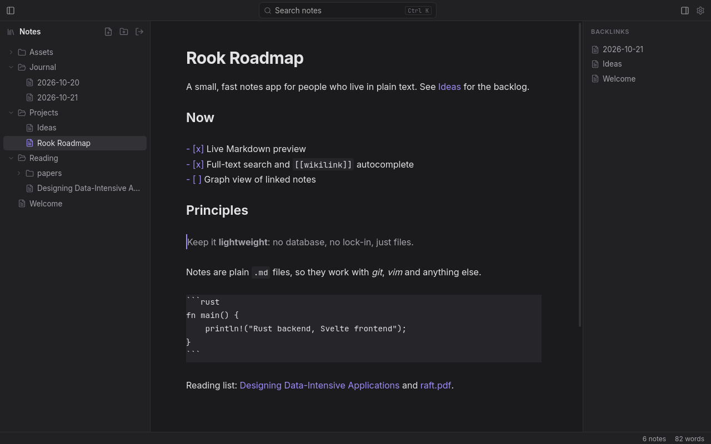
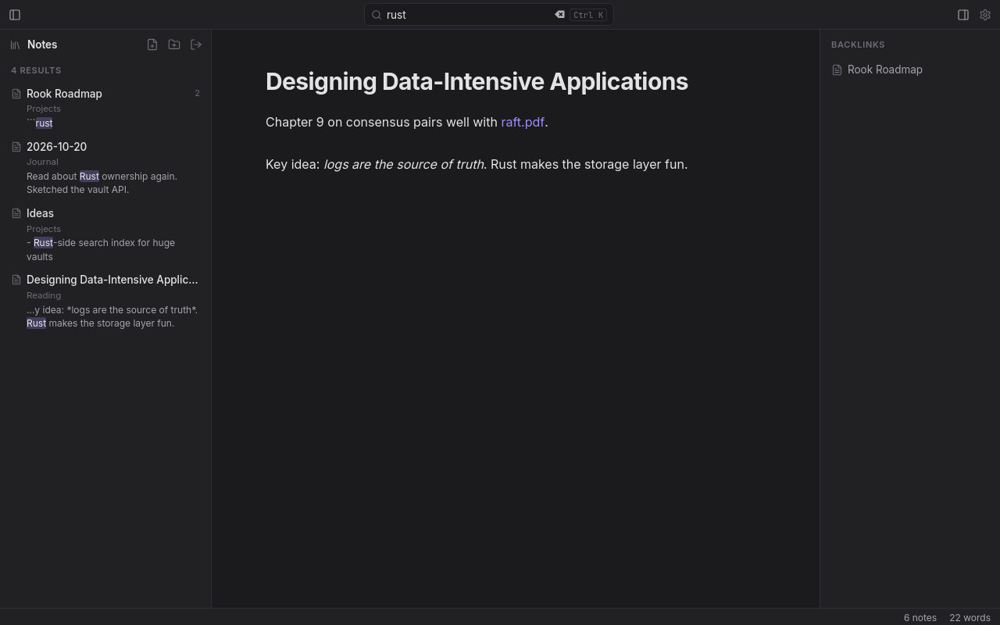
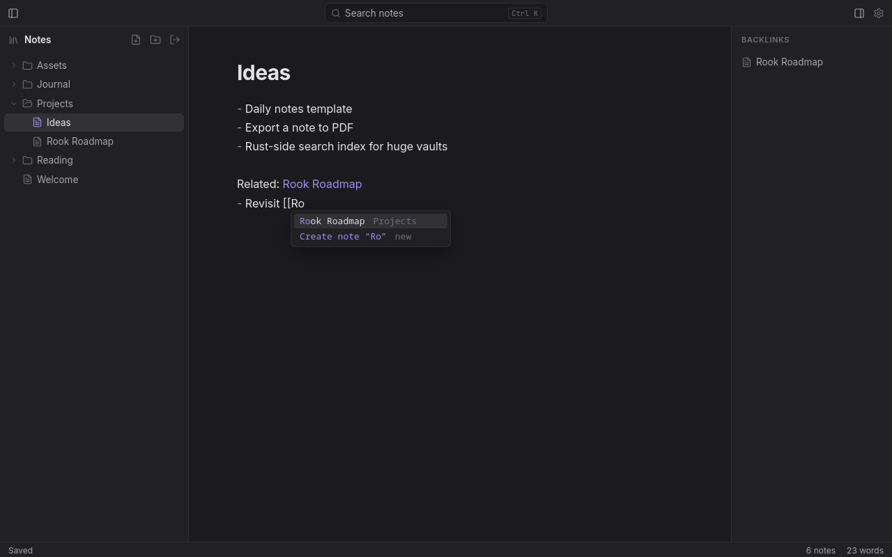
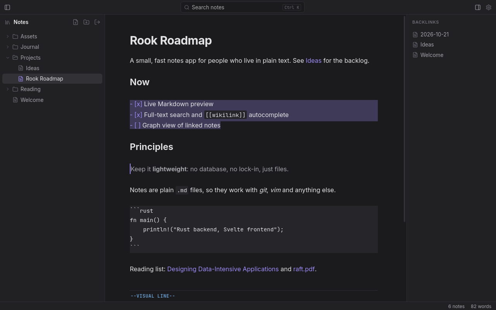
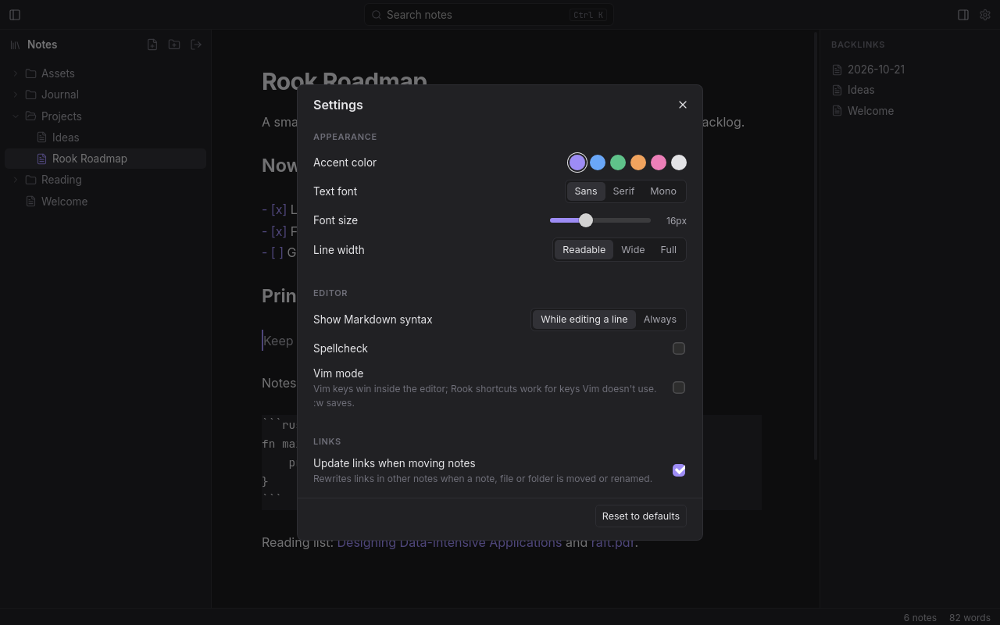
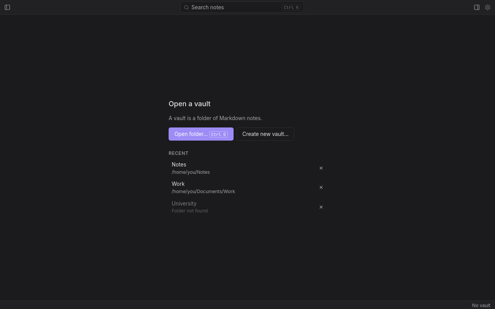

# Rook

A lightweight, Obsidian-inspired desktop note-taking app built with Tauri, Svelte, TypeScript, and Rust.

Your vault is just a folder of Markdown files. There's no database, no account and no lock-in, so your notes keep working with git, vim and everything else.



## Features

- **Live Markdown preview.** Headings, bold, italic, code, quotes, lists and links render as you type. The Markdown syntax hides itself except on the line you're editing.
- **Wikilinks.** Link notes with `[[Note]]`, `[[Note#Heading]]` or `[[Note|alias]]`. Typing `[[` suggests notes, files and headings. Links to notes that don't exist yet are dimmed, and clicking one creates the note.
- **Backlinks.** See which notes link to the one you're reading.
- **Full-text search.** Search every note's contents, with highlighted snippets. Clicking a result jumps to the match.
- **Folders and drag-and-drop.** Organise notes, PDFs, images and videos in folders. Drag anything in the sidebar to move it.
- **Links update when you move things.** Renaming or moving a note, file or folder rewrites the links that point to it.
- **PDFs, images and videos** appear in the sidebar and open in your default app, so you can take notes side by side.
- **Vim mode (optional).** Motions, operators, text objects, visual mode, registers and `:w`, with a mode line and key buffer at the bottom of the editor.
- **Settings.** Accent color, text font, font size, line width, syntax display, spellcheck and link updating.
- **Safe with your files.** Saves never silently overwrite. If a note was changed outside Rook (in vim, say) since you opened it, Rook asks before writing.

## Screenshots

| | |
|---|---|
|  |  |
| **Full-text search** across all notes | **`[[` autocomplete** for notes, files and headings |
|  |  |
| **Vim mode** with the mode line in the editor | **Settings** |



When no vault is open, Rook shows the vault picker. You can open a folder, create a new vault, or pick a recent one. The last vault you used reopens on launch.

## Keyboard shortcuts

| Shortcut | Action |
|---|---|
| `Ctrl+N` | New note |
| `Ctrl+Shift+N` | New folder |
| `Ctrl+O` | Open a vault folder |
| `Ctrl+K` | Search (`Enter` opens the top result) |
| `Ctrl+S` | Save now (notes also save automatically) |
| `Ctrl+\` | Toggle sidebar |
| `Ctrl+Shift+B` | Toggle backlinks |
| `Ctrl+,` | Settings |
| Click / `Ctrl+Click` | Follow a link (`Ctrl` is needed on the line you're editing) |

On macOS, use `Cmd` instead of `Ctrl`. In Vim mode, Vim keys take priority inside the editor. Rook's shortcuts still work for any key Vim doesn't use.

## How it works

- **Notes are plain files.** A vault is a folder. Notes are `.md` files inside it, and folders are real folders. Hidden files and folders (such as `.git`) are ignored.
- **The Rust backend does every file operation.** The webview can't choose arbitrary paths. Every path is checked against the open vault, which rejects `..`, absolute paths and symlinks pointing outside. Writes are atomic: a temp file is written, then renamed over the note.
- **Settings stay on your machine.** Panel widths and preferences are stored locally. The recent-vaults list lives in the app's config folder.

## Requirements

- Node.js
- pnpm
- Rust toolchain (`rustup`, `rustc`, `cargo`)
- Tauri system dependencies ([Fedora setup](https://v2.tauri.app/start/prerequisites/))

## Development

Enter the project directory:

```bash
cd rook
```

Install dependencies:

```bash
pnpm install
```

Start the desktop app in development mode:

```bash
pnpm tauri dev
```

The app window will open automatically. Changes to the frontend will generally trigger a hot reload.

Run the checks:

```bash
pnpm check                      # Svelte and TypeScript
cd src-tauri && cargo test      # Rust vault tests (paths, moves, symlinks, conflicts)
```

## Production Build

Build the application for your current platform:

```bash
pnpm tauri build
```

The generated packages and binaries will be available under:

```text
src-tauri/target/release/bundle/
```

## Project structure

```text
src/
  routes/+page.svelte     App state: vault, saving, links, moves, search
  lib/components/         Sidebar, editor, toolbar, dialogs, settings
  lib/editor/             CodeMirror setup, live preview, autocomplete, Vim mode
  lib/search.ts           Full-text search
  lib/linkUpdate.ts       Rewrites links when notes move
src-tauri/src/
  vault.rs                Tauri commands: notes, folders, files, vaults
  paths.rs                Path validation and vault containment
  vaults.rs               Recent vaults list
```

## Tech Stack

- **Tauri 2**: desktop application runtime
- **Svelte**: UI framework
- **TypeScript**: frontend language
- **Rust**: native backend
- **CodeMirror 6**: editor, with an optional Vim mode
- **pnpm**: package manager
